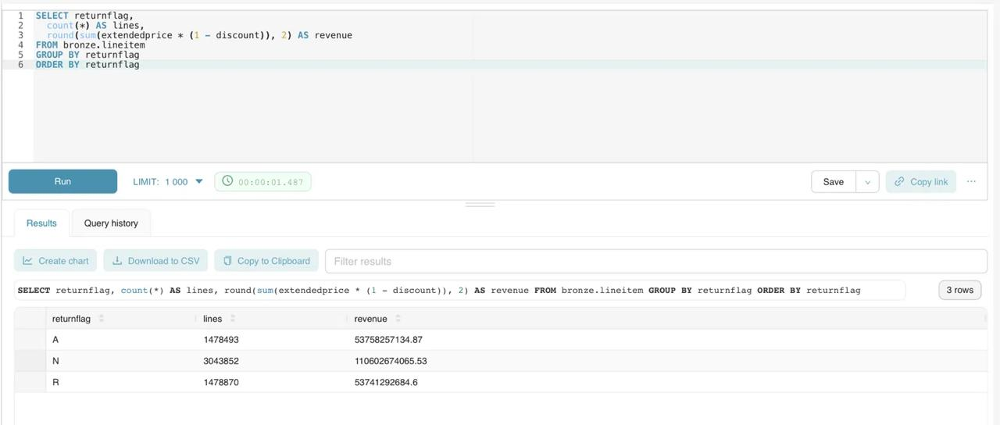

# Отчёт по практической №1 — локальный Lakehouse

**Репозиторий:** https://github.com/Goose-Ki/lakehouse-tpch-q10

## 1. Вариант и масштаб

| Поле | Значение |
|---|---|
| ФИО (как в VK Education) | Гусев Дмитрий |
| Репозиторий | https://github.com/Goose-Ki/lakehouse-tpch-q10 |
| Вариант (запрос) | Q10 «Returned Item Reporting» (вариант 2) |
| Масштаб `sfN` | sf1 |
| Почему выбрал такой масштаб | При sf1 в `lineitem` 6 001 215 строк — уже достаточно, чтобы сжатие давало разницу в разы (Bronze без сжатия 486 МБ, с ZSTD 190 МБ), а партиционирование — заметную экономию чтения. При этом весь стек и бенчмарк из 6 комбинаций формат/кодек укладываются в ~5 минут на MacBook Air в Docker Desktop. sf10 (60 млн строк) упёрся бы в память Docker на ноутбуке, а сравнение кодеков дало бы те же выводы. Масштаб один на всех слоях. |

## 2. Поднятые сервисы — и почему именно они

Проверено `docker compose ps -a`: `lakehouse-minio`, `lakehouse-pg`, `lakekeeper`, `trino` — Up (healthy); служебные `lakehouse-minio-init`, `lakekeeper-migrate`, `lakekeeper-init` — Exited (0).

| Сервис | Роль в стеке | Почему именно он (а не альтернатива) |
|---|---|---|
| MinIO (S3-совместимый форк Silo, `pgsty/minio`) | Объектное хранилище, сюда физически ложатся parquet/orc-файлы | Говорит по S3 API, поэтому весь стек без изменений переносится на AWS S3 или Yandex Object Storage — меняется только endpoint. Хранение отделено от вычислений: можно масштабировать диск и движок независимо. Официальные образы MinIO больше не публикуются, форк полностью совместим по API. |
| PostgreSQL 16 | БД, где Lakekeeper хранит метаданные каталога | Транзакционная БД: две одновременные записи в таблицу Iceberg не испортят указатель на текущий снапшот. Это штатный и единственный поддерживаемый Lakekeeper бэкенд; alpine-образ лёгкий. |
| Lakekeeper | Iceberg REST Catalog | Реализует открытый стандарт Iceberg REST, поэтому к тем же таблицам можно подключить не только Trino, но и Spark, DuckDB, StarRocks. Написан на Rust — один маленький контейнер без JVM, в отличие от Hive Metastore. Есть веб-UI для просмотра warehouse и таблиц. Открытый код (Apache 2.0). |
| Trino 476 | SQL-движок: метаданные берёт у Lakekeeper, данные читает/пишет в MinIO | Встроенный коннектор `tpch` генерирует данные на лету — ничего не надо скачивать. Iceberg-коннектор умеет CTAS, MERGE, time travel, `$files`/`$snapshots`, выбор формата и кодека. MPP-движок на чистом SQL: в отличие от Spark не нужен кластер и ноутбуки, вся работа — SQL-файлы. |
| Superset 6.0 (профиль `bi`) | BI поверх Trino: SQL Lab и графики по Bronze/Gold | Открытый BI, подключается к Trino одной строкой URI через официальный драйвер `trino`, поэтому видит все слои lakehouse без отдельного коннектора к S3. Подробнее — п. 6.2. |

### Скрипты, которыми поднимал стек

Весь стек описан в `docker-compose.yml` в корне репозитория; ниже — команды запуска.

```bash
docker compose up -d                 # MinIO, Postgres, Lakekeeper, Trino + init-контейнеры:
                                     #   minio-init       — создаёт бакет lakehouse
                                     #   lakekeeper-migrate — миграции схемы каталога в Postgres
                                     #   lakekeeper-init  — bootstrap каталога и warehouse поверх бакета
docker compose ps -a                 # проверка статусов
docker logs lakekeeper-init          # warehouse создан: "warehouse-id", "status":"active"
docker compose --profile bi up -d --build superset   # BI, запускается после бенчмарка

# Медальон
docker exec trino trino --file /sql/00_schemas.sql
docker exec trino trino --session lakehouse.compression_codec=ZSTD --file /sql/01_bronze.sql
docker exec trino trino --session lakehouse.compression_codec=ZSTD --file /sql/02_silver.sql
docker exec trino trino --session lakehouse.compression_codec=ZSTD --file /sql/03_gold.sql

# Проверки и замеры
docker exec trino trino --file /sql/04_check.sql
docker exec trino trino --session lakehouse.compression_codec=ZSTD --file /sql/06_partition_compare.sql
./bench.sh
```

Конфигурация Trino — `trino/catalog/lakehouse.properties` (Iceberg REST → `http://lakekeeper:8181/catalog`, S3 → `http://minio:9000`) и `trino/catalog/tpch.properties`. Кодек записи задаётся сессионным свойством `lakehouse.compression_codec`.

## 3. Разбор запроса — какие данные нужны

Q10 ищет 20 клиентов, принёсших больше всего выручки возвращёнными позициями (`returnflag = 'R'`) из заказов IV квартала 1993 года. Выручка строки — `extendedprice * (1 - discount)`.

| Таблица TPC-H | Нужные колонки | Что запрос с ними делает (фильтр / джойн / агрегат / вывод) |
|---|---|---|
| `lineitem` | `orderkey`, `extendedprice`, `discount`, `returnflag` | фильтр `returnflag = 'R'`; джойн с `orders` по `orderkey`; агрегат `sum(extendedprice * (1 - discount))` |
| `orders` | `orderkey`, `custkey`, `orderdate` | фильтр `orderdate` в `[1993-10-01, 1994-01-01)`; джойн с `customer` по `custkey` и с `lineitem` по `orderkey` |
| `customer` | `custkey`, `name`, `acctbal`, `nationkey`, `address`, `phone`, `comment` | джойн с `orders` и `nation`; все поля, кроме `nationkey`, — ключи группировки и вывод |
| `nation` | `nationkey`, `name` | джойн с `customer` по `nationkey`; `name` выводится как страна |

## 4. Медальон — решения по каждому слою

Строки — `count(*)`, вес — сумма `file_size_in_bytes` из Iceberg-таблицы `"<таблица>$files"` (только data-файлы текущего снапшота, без метаданных). Источник цифр — `sql/04_check.sql`.

Общая логика кодеков: везде **Parquet + ZSTD**. Бенчмарк (п. 5) показал, что ZSTD всего на 3% больше GZIP по размеру, но пишется на 23% быстрее, а читается не медленнее. Parquet выбран вместо ORC, потому что он колоночный стандарт де-факто для Iceberg и BI-инструментов, а по замерам ORC не выиграл ни в размере, ни в скорости.

### Bronze (сырой)

| Таблица | Колонки (что оставил) | Строк | Вес, МБ | Формат | Сжатие | Партиционирование | Обоснование |
|---|---|---|---|---|---|---|---|
| `bronze.lineitem` | все 16 колонок | 6 001 215 | 147.3 | PARQUET | ZSTD | нет | Bronze — копия источника «как есть»: если завтра понадобится витрина по `shipmode` или `tax`, не придётся заново грузить источник. Партиции здесь не нужны: Bronze не читается аналитикой напрямую, а пересобирается в Silver целиком. ZSTD — лучший баланс размер/скорость записи для самой большой таблицы. |
| `bronze.orders` | все 9 колонок | 1 500 000 | 35.0 | PARQUET | ZSTD | нет | То же. |
| `bronze.customer` | все 8 колонок | 150 000 | 7.8 | PARQUET | ZSTD | нет | То же; маленький справочник. |
| `bronze.nation` | все 4 колонки | 25 | < 0.01 | PARQUET | ZSTD | нет | Справочник из 25 строк, один файл. |

### Silver (очищенный)

| Таблица | Колонки (что оставил) | Строк | Вес, МБ | Формат | Сжатие | Партиционирование | Обоснование |
|---|---|---|---|---|---|---|---|
| `silver.customer_nation` | `custkey`, `name`, `address`, `phone`, `acctbal`, `comment`, `nation` | 150 000 | 7.7 | PARQUET | ZSTD | нет | Обогащение: клиент сразу со страной, `nationkey` больше не нужен. Очистка: `trim` строк, отсев пустых ключей. Справочник читается целиком при джойне — партиции бесполезны. |
| `silver.returned_lines` | `orderkey`, `linenumber`, `custkey`, `orderdate`, `extendedprice`, `discount`, `net_revenue` | 1 478 870 | 21.3 | PARQUET | ZSTD | `year(orderdate)`, 4 партиции | Факт «возвращённые позиции»: `lineitem ⋈ orders`, только `returnflag = 'R'`, с уже посчитанной выручкой строки. Фильтры качества: `extendedprice > 0`, `discount` в `[0, 1]`. Хранятся все годы, а не только Q4-1993: слой переиспользуем для любого периода, срез делает Gold. Партиций 4 (1992–1995): в TPC-H флаг `R` получают только позиции, полученные до 1995-06-17. Замер (`06_partition_compare.sql`): запрос за Q4-1993 читает 1 партицию — 454 138 строк / 3.7 МБ с диска против 1 478 870 строк / 12.3 МБ без партиций (в 3.3 раза меньше), CPU скана 19 мс против 54 мс. Цена — 4 файла вместо 1 и +3% к весу (21.3 vs 20.6 МБ). Партиции по месяцу дали бы ~40 файлов по ~0.5 МБ — слишком мелко. |

### Gold (витрина)

| Таблица | Колонки | Строк | Вес, МБ | Формат | Сжатие | Партиционирование | Обоснование |
|---|---|---|---|---|---|---|---|
| `gold.top20_returned_customers` | `custkey`, `name`, `revenue`, `acctbal`, `nation`, `address`, `phone`, `comment` | 20 | < 0.01 | PARQUET | ZSTD | нет | Готовый ответ Q10 — BI читает 20 строк, без джойнов. Срез по Q4-1993 и группировка по клиенту делаются здесь из Silver. На 20 строках партиции и выбор кодека роли не играют; ZSTD оставлен для единообразия слоёв. |

**Проверка корректности.** `04_check.sql` сравнивает Gold с эталонным Q10, выполненным прямо по `tpch.sf1`, через `EXCEPT` в обе стороны по `(custkey, round(revenue, 2))`: результат `0, 0` — расхождений нет. Первые строки витрины:

| # | custkey | Клиент | Выручка | Страна |
|---:|---:|---|---:|---|
| 1 | 57040 | Customer#000057040 | 734 235.25 | JAPAN |
| 2 | 143347 | Customer#000143347 | 721 002.69 | EGYPT |
| 3 | 60838 | Customer#000060838 | 679 127.31 | BRAZIL |
| 4 | 101998 | Customer#000101998 | 637 029.57 | UNITED KINGDOM |
| 5 | 125341 | Customer#000125341 | 633 508.09 | GERMANY |

Выручка хранится как `double` (так её отдаёт коннектор `tpch`), поэтому в сырых значениях есть хвосты вида `734235.2455000001`; в отчёте округлено до копеек.

## 5. Тесты производительности

Методика (`bench.sh`): для каждой пары формат + кодек четыре таблицы Bronze пересоздаются из `tpch.sf1` в отдельной схеме `bench_<формат>_<кодек>`. Время записи — суммарное время четырёх CTAS. Размер — сумма `file_size_in_bytes` по `$files`. Q10 по этому Bronze — один прогрев и 5 замеров, время берётся из `system.runtime.queries` (`end − created`), в таблице медиана. Условия: MacBook Air, Docker Desktop, Trino 476, всё на одной машине.

| Сжатие на Bronze | Время запроса | Размер Bronze, МБ | Твой вывод (что лучше и почему) |
|---|---|---|---|
| GZIP | 1.0 с (0.9–1.0) | 184.9 | Самый компактный, но запись самая медленная — 27.4 с: GZIP сжимает сильнее, тратя больше CPU. Подходит для холодного архива, который пишут редко. |
| ZSTD | 0.8 с (0.8–1.0) | 190.0 | Всего на 2.8% больше GZIP, зато запись 21.0 с — на 23% быстрее, чтение не медленнее. Лучший баланс, поэтому выбран для всех слоёв. |

Расширенное сравнение форматов и кодеков:

| Формат | Кодек | Запись, с | Bronze, МБ | из них lineitem, МБ | Q10, 5 прогонов, с | Q10 медиана, с |
|---|---|---:|---:|---:|---|---:|
| PARQUET | GZIP | 27.41 | 184.9 | 143.7 | 1.0, 0.9, 0.9, 1.0, 1.0 | 1.0 |
| PARQUET | ZSTD | 21.04 | 190.0 | 147.2 | 1.0, 0.8, 0.8, 0.8, 1.0 | 0.8 |
| PARQUET | SNAPPY | 16.19 | 261.3 | 198.4 | 0.9, 0.7, 0.8, 0.8, 0.8 | 0.8 |
| PARQUET | NONE | 17.84 | 486.4 | 355.6 | 0.9, 1.1, 0.7, 1.0, 0.8 | 0.9 |
| ORC | GZIP | 22.80 | 188.0 | 148.6 | 1.1, 0.9, 0.9, 1.0, 0.9 | 0.9 |
| ORC | ZSTD | 17.33 | 193.6 | 153.8 | 0.9, 0.9, 0.9, 0.8, 0.7 | 0.9 |

Выводы из замеров:

- **Сжатие нужно обязательно.** Без него Bronze в 2.6 раза больше (486 МБ против 185–194 МБ). Интересно, что NONE пишется даже медленнее SNAPPY: на диск уходит вдвое больше байт, и экономия CPU съедается вводом-выводом.
- **SNAPPY — самый быстрый на запись** (16.2 с), но на 37% больше ZSTD. Разумен для горячих промежуточных данных, где важна скорость, а не место.
- **GZIP vs ZSTD:** разница в размере 3%, в скорости записи — 23% в пользу ZSTD.
- **Время Q10 почти не зависит от кодека:** все варианты 0.7–1.1 с, и разброс внутри одной серии сравним с разницей между сериями. На sf1 запрос упирается в джойны и планирование, а не в распаковку. Точность замера ~0.1 с, поэтому разницу 0.1–0.2 с значимой не считаю.
- **ORC vs Parquet:** при одинаковом кодеке ORC на 2% больше, по скорости — в пределах шума. Явного выигрыша нет, поэтому остался Parquet как более распространённый формат.

## 6. Часть 2 — осмысление и работа с инструментами

### 6.1. Понять и объяснить

| Вопрос | Твой ответ |
|---|---|
| Зачем нужны большие данные и lakehouse (а не обычная БД/хранилище)? | Обычная OLTP-БД хранит строки на дорогом диске одного сервера и рассчитана на точечные запросы; аналитика по миллиардам строк в ней медленная и дорогая, а места не хватит. Data lake дешёво хранит любые объёмы в объектном хранилище, но это просто файлы — нет транзакций, схемы и истории. Lakehouse берёт лучшее из двух: данные лежат в дешёвом S3 в открытых колоночных форматах (Parquet), а табличный формат Iceberg добавляет поверх них ACID-транзакции, схему, её эволюцию и снапшоты. Хранение и вычисления разделены: одни и те же таблицы читают Trino, Spark и BI, а движок можно масштабировать или заменить, не трогая данные. В этой работе это видно на практике: Bronze 6 млн строк сжался до 190 МБ, а таблицу можно откатить к любому снапшоту. |
| Пример schema evolution на Silver: добавил/переименовал колонку — что произошло? | На `silver.customer_nation` (скрипт `sql/05_evolution_timetravel.sql`, часть A). Исходная схема — 7 колонок. `ADD COLUMN segment varchar` выполнился мгновенно: у всех 150 000 старых строк `segment` пустой (NULL), потому что Iceberg записал только новую версию схемы в метаданные, а parquet-файлы не трогал. Затем `MERGE` из `bronze.customer` заполнил колонку: AUTOMOBILE — 29 752, BUILDING — 30 142, FURNITURE — 29 968, HOUSEHOLD — 30 189, MACHINERY — 29 949 (в сумме 150 000). `RENAME COLUMN phone TO phone_number` — `DESCRIBE` сразу показал новое имя, данные читаются без ошибок: Iceberg хранит колонки по числовому id, а не по имени. Затем имя возвращено, чтобы `03_gold.sql` продолжал работать. Важное наблюдение из `$snapshots`: `ADD COLUMN` и оба `RENAME` **не создали снапшотов** — изменение схемы затрагивает только метаданные. Новый снапшот (`overwrite`, id 1674835678824995261) появился только от `MERGE`, который реально переписал данные. |
| Пример скрипта восстановления данных из снапшота (time travel) | Часть B того же скрипта. Снапшот до аварии — `1674835678824995261`. «Авария»: `DELETE FROM silver.customer_nation WHERE nation = 'GERMANY'` — клиентов из Германии было 5 908, стало 0; в истории появился снапшот `delete`. Чтение прошлого: `SELECT count(*) FROM silver.customer_nation FOR VERSION AS OF 1674835678824995261 WHERE nation = 'GERMANY'` → 5 908 — старая версия доступна, хотя в текущей строк нет. Восстановление: `INSERT INTO silver.customer_nation SELECT * FROM silver.customer_nation FOR VERSION AS OF 1674835678824995261 WHERE nation = 'GERMANY'` → снова 5 908, всего в таблице 150 000 — как до аварии. Восстановлены только потерянные строки, а не вся таблица целиком, и история сохранилась для аудита: `append → overwrite → delete → append`. Сценарий прогнан трижды (id снапшота до аварии каждый раз брался автоматически из `$snapshots`), результат одинаковый: 5 908 → 0 → 5 908. |

### 6.2. Подключить инструмент к lakehouse

| Инструмент | Почему выбрал именно его |
|---|---|
| Apache Superset 6.0 (BI) | Задача — показать данные бизнес-пользователю, а не обрабатывать их, поэтому нужен BI, а не второй движок. Superset открытый, ставится одним контейнером и подключается к Trino через официальный драйвер `trino` — значит, сразу видит все три слоя lakehouse без отдельной настройки S3 и Iceberg. Spark/StarRocks дублировали бы роль Trino, а Metabase для Trino требует сторонний плагин. |

Развёртывание — сервис `superset` в `docker-compose.yml` (профиль `bi`) и `superset/Dockerfile`, который ставит драйвер `trino` в образ `apache/superset:6.0.0`:

```bash
docker compose --profile bi up -d --build superset
docker logs -f superset          # ждём "Booting worker"
```

Действия в UI:

1. Открыл `http://localhost:8088`, вошёл `admin / admin`.
2. Settings → Database Connections → + Database → Trino, SQLAlchemy URI: `trino://admin@trino:8080/lakehouse` → Test Connection → Connect.
3. SQL Lab, схема `bronze`, запрос по Bronze:
   ```sql
   SELECT returnflag, count(*) AS lines, round(sum(extendedprice * (1 - discount)), 2) AS revenue
   FROM bronze.lineitem
   GROUP BY returnflag
   ORDER BY returnflag;
   ```
   Запрос выполнился за 1.49 с и вернул 3 строки:

| returnflag | Строк | Выручка |
|---|---:|---:|
| A | 1 478 493 | 53 758 257 134.87 |
| N | 3 043 852 | 110 602 674 065.53 |
| R | 1 478 870 | 53 741 292 684.60 |

Сумма строк 1 478 493 + 3 043 852 + 1 478 870 = 6 001 215 — ровно весь `bronze.lineitem`, Superset видит Bronze целиком. Строк с `R` — 1 478 870, ровно столько же, сколько в `silver.returned_lines`: это независимое подтверждение, что при переходе Bronze → Silver ни одна возвращённая позиция не потерялась и не задвоилась.



## 7. Выводы

Медальон разделил ответственность: Bronze хранит полный источник, Silver — очищенный и обогащённый факт возвратов, пригодный для любого периода, а Gold — ответ на один бизнес-вопрос, и корректность Gold подтверждена сверкой с эталонным Q10. Сжатие оказалось главным рычагом экономии: ZSTD уменьшил Bronze в 2.6 раза по сравнению с несжатым и при этом записывается на 23% быстрее GZIP при разнице в размере всего 3%; на скорость Q10 при sf1 кодек заметно не влияет. Партиционирование Silver по году сократило чтение для квартального запроса в 3.3 раза ценой 3% веса, а годовая гранулярность выбрана с учётом данных: возвратов в TPC-H всего 4 года, и месячные партиции дали бы слишком мелкие файлы. Iceberg поверх S3 дал то, чего нет у «просто файлов»: эволюцию схемы без переписывания данных и восстановление удалённых строк из снапшота.
